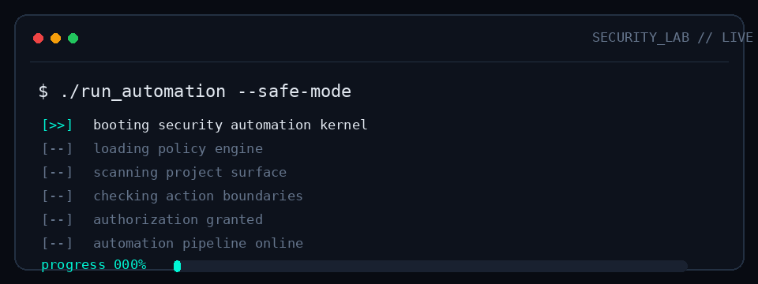

<div align="center">



<a href="https://github.com/rajatayyabb">
  
</a>

<br />

# `TAYYAB ALI`

### `CYBERSECURITY STUDENT` · `SECURITY TOOL BUILDER` · `AI SAFETY EXPLORER`

<a href="https://github.com/rajatayyabb"></a>
<a href="https://github.com/rajatayyabb?tab=repositories"></a>
<a href="https://github.com/rajatayyabb?tab=followers"></a>

</div>

```console
┌──(tayyab㉿github)-[~/security-lab]
└─$ whoami
  cybersecurity student building practical tools for safer systems

└─$ current_mission --print
  learn how systems fail → engineer how they recover → document the journey

└─$ system_status
  [ONLINE] defensive security     [ONLINE] automation     [LEARNING] digital forensics
```

<div align="center">

[ `ABOUT` ](#-about-me) · [ `PROJECTS` ](#-selected-builds) · [ `STACK` ](#-security-stack) · [ `STATS` ](#-github-signal)

</div>

---

## `// ABOUT ME`

I’m **Tayyab Ali**, a cybersecurity student focused on understanding systems from the inside out and turning that knowledge into useful security tooling.

I’m currently exploring **defensive security, Windows internals, ethical hacking, secure software development, digital forensics, and AI agent safety**. I like projects that sit between security research and practical engineering: tools that detect, recover, authorize, automate, or explain.

```yaml
focus:
  - defensive_security
  - security_automation
  - windows_security
  - ai_agent_safety
  - open_source_learning
mindset: "build it, break it safely, understand it, improve it"
mission: "make security knowledge practical and responsible"
```

---

## `// SELECTED BUILDS`

<div align="center">

> **Pinned in this exact order:** `NullShadow-v5` → `cookie-sync` → `SpiderCore-PE` → `WraithForge`

</div>

<table>
<tr>
<td width="50%" valign="top">

### `01` · [NullShadow-v5](https://github.com/rajatayyabb/NullShadow-v5)

> Security-focused project in the lab — experiments, ideas, and tooling on the path to stronger defensive systems.

`SECURITY` `LAB` `EXPERIMENTS`

</td>
<td width="50%" valign="top">

### `02` · [cookie-sync](https://github.com/rajatayyabb/cookie-sync)

> Repository preserved as a clean project archive while the next secure build takes shape.

`ARCHIVE` `SECURITY` `LAB`

</td>
</tr>
<tr>
<td width="50%" valign="top">

### `03` · [SpiderCore-PE](https://github.com/rajatayyabb/SpiderCore-PE)

> Windows PE recovery and cybersecurity toolkit for diagnostics, recovery workflows, and security-focused system utilities.

`WINDOWS` `POWERSHELL` `RECOVERY`

</td>
<td width="50%" valign="top">

### `04` · [WraithForge](https://github.com/rajatayyabb/wraithforge)

> Multi-agent orchestration scaffold for coordinated, security-conscious automation experiments.

`AI AGENTS` `AUTOMATION` `ORCHESTRATION`

</td>
</tr>
</table>

<div align="center">

<a href="https://github.com/rajatayyabb?tab=repositories"></a>

</div>

---

## `// SECURITY STACK`

<div align="center">


<br /><br />


</div>

| Domain | Current direction |
| --- | --- |
| **Defense** | system hardening, detection thinking, security utilities |
| **Systems** | Windows internals, PowerShell, Linux fundamentals |
| **Research** | ethical hacking, vulnerability concepts, forensics |
| **Engineering** | Python tooling, automation, reliable developer workflows |
| **AI security** | runtime authorization, agent boundaries, safe actions |

---

## `// LEARNING QUEUE`

```text
[██████████████░░░░░░]  Defensive Security
[█████████████░░░░░░░]  Security Automation
[████████████░░░░░░░░]  Windows Internals
[███████████░░░░░░░░░]  Digital Forensics
[██████████░░░░░░░░░░]  AI Agent Safety
[█████████░░░░░░░░░░░]  Responsible Vulnerability Research
```

---

## `// GITHUB SIGNAL`

<div align="center">


<br />


<br /><br />


</div>

---

## `// PRINCIPLES`

> **Learn deeply. Build responsibly. Share clearly.**

I believe cybersecurity is strongest when knowledge becomes protection—not noise. Every experiment here is part of a longer path toward building systems that are more observable, recoverable, and difficult to misuse.

```diff
+ Curiosity over shortcuts
+ Responsible research over reckless testing
+ Useful tools over empty complexity
+ Documentation over mystery
```

---

## `// AUTOMATION LINK`

<div align="center">


</div>

```console
┌──(tayyab㉿github)-[~/collaboration] 
└─$ connect --mode=responsible
  [01] bring a real security problem
  [02] build something useful
  [03] document what changed
  [04] ship the safer version
``

## `// CONNECT`

<div align="center">

<a href="https://github.com/rajatayyabb?tab=repositories"></a>
<a href="https://github.com/rajatayyabb?tab=followers"></a>

<br /><br />

<sub>OPEN TO LEARNING, BUILDING, AND SECURITY-FOCUSED COLLABORATION</sub>

<br /><br />


</div>
